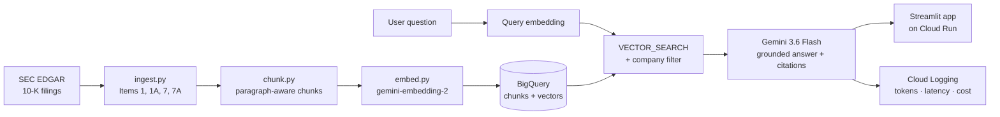

# 10-K Risk Analyst

**Ask questions about public companies' SEC 10-K filings and get answers grounded in, and cited to, the filing text.**

**Live demo:** https://tenk-risk-analyst-985032744087.us-central1.run.app

A retrieval-augmented generation (RAG) system on Google Cloud: it ingests 10-K filings for 10 companies, embeds them with Vertex AI, stores them in BigQuery as a vector database, and answers questions with Gemini, citing the exact passages it used and refusing when the filings don't contain the answer. Every request is traced with LLM metrics (tokens, latency, cost).

---

## Architecture



| Layer | Technology |
|---|---|
| Data source | SEC EDGAR via `edgartools` (latest 10-K, amendments excluded) |
| Embeddings | Vertex AI `gemini-embedding-2` (768 dimensions) |
| Vector database | BigQuery `VECTOR_SEARCH` (cosine distance) with SQL metadata filters |
| Generation | Vertex AI Gemini 3.6 Flash |
| App & hosting | Streamlit, Docker, Cloud Run |
| Observability | Structured JSON logs per request → Cloud Logging |

**Corpus:** 10 companies (Apple, Microsoft, NVIDIA, Amazon, JPMorgan Chase, Johnson & Johnson, ExxonMobil, Walmart, Tesla, Nike) · 4 sections each (Business, Risk Factors, MD&A, Market Risk) · **1,028 chunks**.

---

## Evaluation

A fixed benchmark of 22 questions: 18 answerable (company-specific and cross-company) and 4 "trap" questions whose answers are not in the filings.

| Metric | Result |
|---|---|
| Retrieval hit rate (relevant chunk in top 6) | **100%** |
| Mean reciprocal rank | **0.88** |
| Answers citing a relevant chunk | **100%** |
| Answerable questions wrongly refused | **0%** |
| Trap questions correctly refused | **100%** |
| Answers with invalid (non-retrieved) citations | **0** |
| Cost per question | **≈ $0.004** |

A chunk counts as relevant if it comes from the expected company (and section, where specified) and contains an expected keyword. Run it with `python src/evaluate.py`; each run is saved in `eval/results/`.

**Limitations of this evaluation:** the test set is small and hand-written, most questions name a company (which makes retrieval easier), and keyword-based relevance is lenient. Next steps are listed below.

---

## Structured risk extraction

Besides Q&A, `extract_risks.py` turns a company's Risk Factors into a structured table:

**company | risk cluster | risk summary | evidence quote | source chunk**

- Gemini returns **structured JSON** validated against a Pydantic schema.
- Each risk is assigned to one of **13 fixed clusters** (e.g. Supply chain & operations, Cybersecurity & data privacy, Geopolitical & trade), so companies can be compared.
- Every evidence quote is **checked verbatim against its source chunk**; unverified quotes are flagged and excluded from the summary matrix.
- Output: `outputs/risk_table.csv` and a company × cluster matrix, `outputs/risk_matrix.csv`.

**Pilot (Walmart):** 47 risks extracted, **98% of evidence quotes verified word for word** against the filing.

---

## Design decisions

- **Paragraph-aware chunking.** 10-K risk factors are separate risks under their own headings. Chunks pack whole paragraphs up to 400 words with a one-paragraph overlap, so a risk is never cut in half.
- **Context in every embedding.** Documents are embedded as `title: <company, year, section> | text: <chunk>` and questions as `task: search result | query: <question>` (asymmetric retrieval). The title lets a chunk "know" which company it belongs to.
- **BigQuery as the vector database.** Serverless and pay-per-query (no always-on endpoint billed by the hour), with metadata filtering in plain SQL (`WHERE ticker = @ticker`) next to the vectors. Search is exact (brute force) at this corpus size; a vector index would be added as the corpus grows.
- **Parameterized queries.** The question vector and filters are passed as BigQuery query parameters, never concatenated into SQL.
- **Grounding and refusal.** The model may only use the retrieved excerpts, must cite chunk IDs, and must say "The provided filings don't cover this" otherwise.
- **Citation validation.** Every cited ID is checked against the retrieved set; invented citations are flagged.
- **Resilience.** All external API calls retry with exponential backoff and jitter on rate limits (429), server errors (5xx) and network failures. Embedding and extraction runs are **resumable**: each finished item is cached immediately, so a crash never repeats paid work.
- **Honest metrics.** Time spent waiting on rate limits is tracked separately, so it is not mistaken for model latency.
- **Least privilege and cost control.** The app runs as a dedicated service account with only Vertex AI User, BigQuery Data Viewer and BigQuery Job User. Cloud Run scales to zero when idle, is capped at 2 instances, and limits questions per session.

---

## LLM metrics

Every request logs one JSON line (to `logs/requests.jsonl` locally and Cloud Logging in production):

`question · ticker filter · model · retrieved and cited chunk IDs · invalid citations · retrieval ms · generation ms · rate-limit wait ms · input / output / thinking tokens · output tokens per second · cost (USD)`

Example (Walmart interest rate risk): retrieval ≈ 1.5 s, generation ≈ 1.3 s, 3,525 input / 133 output tokens, ≈ $0.003. Input tokens (the retrieved context) dominate cost, and retrieval, not generation, was the main latency component.

---

## Project structure

```
src/
  ingest.py         # download 10-K sections from SEC EDGAR
  chunk.py          # paragraph-aware chunking with metadata
  embed.py          # parallel embedding with retries + resumable cache
  search.py         # brute-force semantic search (NumPy baseline)
  load_bigquery.py  # load chunks + vectors into BigQuery
  bq_search.py      # VECTOR_SEARCH with company filter
  answer.py         # RAG: retrieve, generate, cite, measure, log
  evaluate.py       # benchmark runner and metrics
  extract_risks.py  # structured risk table with quote verification
  app.py            # Streamlit web app
eval/
  questions.jsonl   # benchmark questions
  results/          # saved evaluation runs
outputs/            # risk table and company x cluster matrix
Dockerfile          # container for Cloud Run
```

---

## Run it yourself

Requires a Google Cloud project with billing, plus the Vertex AI, BigQuery and Cloud Run APIs enabled.

```bash
git clone https://github.com/jetishiemira-hash/tenk-risk-analyst.git
cd tenk-risk-analyst
python3 -m venv .venv && source .venv/bin/activate
pip install -r requirements.txt
gcloud auth application-default login
```

Set `PROJECT` in `src/embed.py` to your project ID, and the identity in `src/ingest.py` (the SEC requires a name and email). Then:

```bash
python src/ingest.py          # download filings
python src/chunk.py           # chunk
python src/embed.py           # embed
python src/load_bigquery.py   # load into BigQuery
python src/answer.py          # ask questions in the terminal
python src/evaluate.py        # run the benchmark
streamlit run src/app.py      # run the web app locally
```

Deploy:

```bash
gcloud run deploy tenk-risk-analyst --source . --region us-central1 \
  --service-account <app-service-account> --allow-unauthenticated \
  --min-instances 0 --max-instances 2 --memory 1Gi
```

---

## Limitations and next steps

- **Evaluation:** expand to harder cross-company questions, add an LLM judge to score answer faithfulness, and run the benchmark automatically on every change.
- **Retrieval quality:** remove boilerplate chunks (e.g. "Table of Contents"), keep bullet lists together, and add diversity re-ranking so one company doesn't dominate cross-company results.
- **Risk extraction:** merge near-duplicate risks across batches, validate the taxonomy against hand-labelled examples, and extend to all 10 companies.
- **Latency:** cache question embeddings and request higher Gemini quota.
- **Structured financials:** load XBRL financial data (revenue, debt, margins) into BigQuery so questions can combine numbers with narrative text.

---

*Built by Emira Jetishi · MS Applied Analytics, Columbia University · [LinkedIn](YOUR-LINKEDIN-URL)*